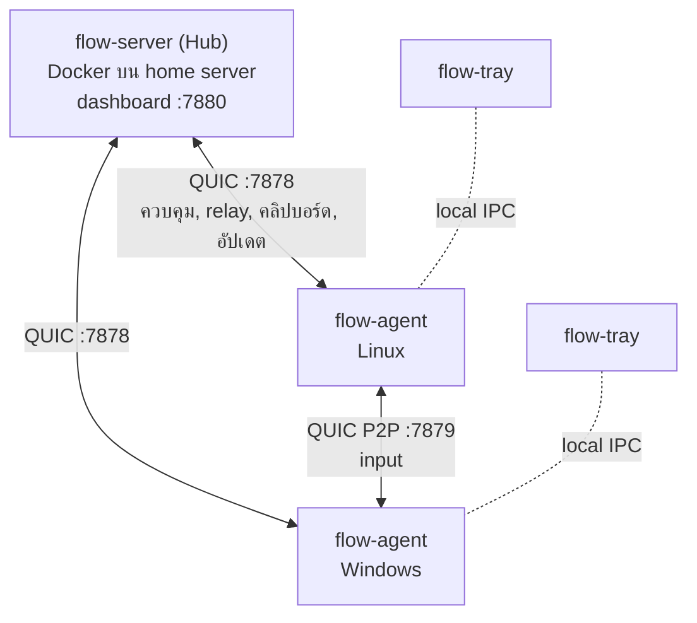

# FlowCursor

Software KVM ที่แชร์เมาส์ คีย์บอร์ด และคลิปบอร์ด (ข้อความและรูป) ระหว่างคอมพิวเตอร์ในวง LAN เดียวกัน
เลื่อนเมาส์ชนขอบจอแล้วไปคุมอีกเครื่องต่อได้เลย ทุกเครื่องใช้เมาส์และคีย์บอร์ดของตัวเองคุมเครื่องอื่นได้ ไม่มีเครื่องหลัก

รองรับ Linux x86_64 (GNOME บน Wayland หรือ Xorg) และ Windows 11 x86_64 ไม่รองรับ macOS

## ทำงานอย่างไร



- **Hub** เก็บรายชื่อเครื่อง ผังจอ และการตั้งค่า แล้วแจกให้ทุกเครื่อง มี dashboard สำหรับจัดผังจอและตั้งค่า
- **Agent** รันบนทุกเครื่อง จับ input ตอนเมาส์ชนขอบจอ แล้วส่งให้เครื่องปลายทาง
- input วิ่งตรงจากเครื่องถึงเครื่อง (P2P) ถ้าเส้นตรงใช้ไม่ได้จะส่งผ่าน hub แทน แล้วกลับมาใช้เส้นตรงเองเมื่อใช้ได้อีก
- ทุกการเชื่อมต่อเข้ารหัสด้วย QUIC (TLS 1.3) และยืนยันตัวตนทั้งสองฝั่ง
- **flow-tray** แสดงไอคอนสถานะและหน้าต่างสถานะของ agent บนเครื่องนั้น
- agent อัปเดตตัวเองจาก hub ที่ join ไว้ deploy hub ใหม่แล้วทุกเครื่องตามมาเอง

## เริ่มใช้งาน

ต้องมี Docker บนเครื่องที่ใช้ build และบน server

**1. Build และรัน hub**

```bash
build/build.sh
cd deploy && FLOW_ADMIN_TOKEN='รหัส-dashboard' docker compose up -d
docker compose exec flow-server flow-server --print-token   # join token
```

เปิด `http://<server>:7880` แล้วใส่รหัส dashboard

**2. ติดตั้ง agent บน Linux** จาก `build/out/linux/`

```bash
./install.sh <join token> <ที่อยู่ hub>
```

GNOME จะขอสิทธิ์สองครั้ง (Remote Desktop ขอตอนต่อ hub ได้ครั้งแรก) กดอนุญาตทั้งคู่

**3. ติดตั้ง agent บน Windows** ดับเบิลคลิก `build/out/windows/FlowCursor-setup-<เวอร์ชัน>.exe`
แล้ววาง join token และที่อยู่ hub ในหน้า Join

**4. จัดผังจอ** ใน dashboard ลากจอให้ตรงกับที่วางบนโต๊ะจริง แล้วกด Save layout

ถ้า agent อยู่คนละวงกับ hub ให้ระบุที่อยู่ hub เสมอ เพราะ mDNS ข้ามวงไม่ได้

## เอกสาร

| หน้า | เนื้อหา |
| :--- | :--- |
| [ติดตั้ง hub](docs/install-hub.md) | Docker Compose, พอร์ต, ข้อมูลใน volume, รหัส dashboard |
| [ติดตั้งบน Linux](docs/install-linux.md) | `install.sh` หรือ `.deb`, สิทธิ์ของ GNOME, คลิปบอร์ด, ไอคอนบนแถบด้านบน |
| [ติดตั้งบน Windows](docs/install-windows.md) | ตัวติดตั้ง, ติดตั้งแบบสคริปต์, โหมด elevated |
| [Dashboard และการตั้งค่า](docs/settings.md) | ผังจอ, วงที่อนุญาต, ปุ่มข้ามจอ, เคอร์เซอร์, hotkey, ไฟล์ config |
| [ไอคอนและหน้าต่างสถานะ](docs/tray.md) | สถานะของไอคอน, เมนู, คำสั่ง `flow-agent` |
| [อัปเดตอัตโนมัติ](docs/updates.md) | การอัปเดตจาก hub, policy, rollback, ติดตั้งด้วยมือครั้งแรก |
| [สถาปัตยกรรม](docs/architecture.md) | P2P และ relay, ความปลอดภัย, keycode, โครงสร้าง repo |
| [Build และทดสอบ](docs/development.md) | build จากซอร์ส, test, วัด latency |
| [แก้ปัญหาและข้อจำกัด](docs/troubleshooting.md) | อาการที่พบบ่อย และสิ่งที่ยังทำไม่ได้ |

## สถานะ

ตรรกะทั้งหมดผ่าน integration test ที่รัน hub จริงกับ agent จำลอง ใช้งานจริงบน Zorin OS 17 (GNOME 46, Wayland) กับ Windows 11 แล้ว
แต่บางส่วนยังไม่เคยรันบนเครื่องจริง เช่น การอัปเดตตัวเองบน Windows ดูรายการที่ [แก้ปัญหาและข้อจำกัด](docs/troubleshooting.md#ข้อจำกัด)
