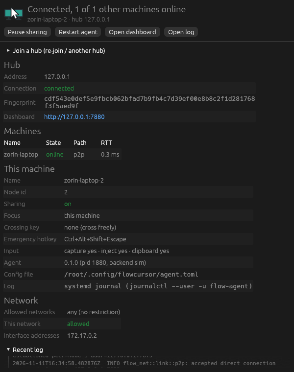

# FlowCursor (`flow-cursor`)

**Software KVM** สำหรับแชร์เมาส์ คีย์บอร์ด และคลิปบอร์ด (ข้อความ + รูปภาพ) ระหว่างคอมพิวเตอร์ในวง LAN เดียวกัน
มี **Hub** (`flow-server`) รันเป็น Docker container บน Home Server และ **Agent** (`flow-agent`) บนทุกเครื่อง
รองรับตอนนี้: **Linux x86_64** (Zorin OS / Ubuntu, GNOME บน Wayland หรือ Xorg) และ **Windows 11 x86_64**

> สถานะ: เวอร์ชันแรก (MVP) — ทดสอบอัตโนมัติด้วย backend จำลองครบทุกเส้นทาง (ลงทะเบียน, สลับ focus, P2P ↔ relay, คลิปบอร์ด)
> แต่ **ยังไม่ได้ทดสอบกับฮาร์ดแวร์จริง** (Wayland/GNOME และ Windows) ดูหัวข้อ [ข้อจำกัดที่รู้อยู่](#ข้อจำกัดที่รู้อยู่)

---

## สารบัญ
1. [หลักการทำงาน](#หลักการทำงาน)
2. [สถาปัตยกรรม](#สถาปัตยกรรม)
3. [ติดตั้ง Hub ด้วย Docker Compose](#ติดตั้ง-hub-ด้วย-docker-compose)
4. [ติดตั้ง Agent บน Zorin OS / Linux](#ติดตั้ง-agent-บน-zorin-os--linux)
5. [ติดตั้ง Agent บน Windows 11](#ติดตั้ง-agent-บน-windows-11)
6. [ไอคอนถาดระบบ (tray) และหน้าต่างสถานะ](#ไอคอนถาดระบบ-tray-และหน้าต่างสถานะ)
7. [Dashboard และหน้า Settings](#dashboard-และหน้า-settings)
8. [ใช้งานเฉพาะในเครือข่ายที่อนุญาต (allowed networks)](#ใช้งานเฉพาะในเครือข่ายที่อนุญาต-allowed-networks)
9. [กดปุ่มค้างเพื่อข้ามจอ (crossing key)](#กดปุ่มค้างเพื่อข้ามจอ-crossing-key)
10. [ไฟล์ตั้งค่าของ Agent](#ไฟล์ตั้งค่าของ-agent)
11. [Emergency hotkey](#emergency-hotkey)
12. [Build จากซอร์ส](#build-จากซอร์ส)
13. [การทดสอบและวัด latency](#การทดสอบและวัด-latency)
14. [ข้อจำกัดที่รู้อยู่](#ข้อจำกัดที่รู้อยู่)
15. [แก้ปัญหาเบื้องต้น](#แก้ปัญหาเบื้องต้น)

---

## หลักการทำงาน

* **ทุกเครื่องเป็นต้นทางของ input ได้** — แตะเมาส์/คีย์บอร์ดของเครื่องไหน ก็ใช้คุมเครื่องอื่นได้ ไม่มี "เครื่องหลัก"
  เครื่องใดดับหรือหลับ เครื่องอื่นยังทำงานต่อได้
* เมื่อเลื่อนเมาส์ชนขอบจอที่ layout ระบุว่าต่อกับอีกเครื่อง agent ของเครื่องต้นทางจะ "จับ" (capture) เมาส์/คีย์บอร์ดของตัวเอง
  แล้วส่ง event ไปให้เครื่องปลายทาง inject — เลื่อนต่อไปเครื่องที่สามได้ และเลื่อนกลับก็คืนการควบคุมให้เครื่องตัวเอง
* ตำแหน่งที่โผล่ฝั่งปลายทางคำนวณแบบ **proportional** (ชนขอบที่ 50% ความสูง → โผล่ที่ 50% ของอีกเครื่อง แม้ความละเอียดต่างกัน)
* คลิปบอร์ด (ข้อความ / รูป) ที่ก็อปบนเครื่องใด จะถูกส่งไปทุกเครื่องผ่าน Hub (เปิด/ปิด และจำกัดขนาดได้ใน Settings)

## สถาปัตยกรรม

```
                    ┌───────────────────────────────────────────┐
                    │   flow-server (Hub, Docker, host network) │
                    │  - ทะเบียนเครื่อง + pairing (join token)    │
                    │  - Layout จอ (บันทึกลง volume)             │
                    │  - Focus state, Settings, Clipboard broker │
                    │  - สมุดที่อยู่ peer + fingerprint            │
                    │  - Relay input (สำรองเมื่อ P2P ใช้ไม่ได้)     │
                    │  - Web dashboard :7880, mDNS               │
                    └──────┬──────────────────────────┬─────────┘
          QUIC :7878 (control, relay, clipboard)   QUIC :7878
                           │                          │
                 ┌─────────┴────────┐  QUIC P2P  ┌────┴─────────────┐
                 │ flow-agent (Linux)│◄──:7879──►│ flow-agent (Win11)│
                 │ capture/inject    │  input     │ capture/inject    │
                 └─────────┬─────────┘            └────┬──────────────┘
              local IPC (socket/pipe เฉพาะผู้ใช้)         │
                 ┌─────────┴─────────┐            ┌────┴──────────────┐
                 │ flow-tray: ไอคอน + │            │ flow-tray: ไอคอน + │
                 │ หน้าต่างสถานะ       │            │ หน้าต่างสถานะ       │
                 └───────────────────┘            └───────────────────┘
```

Agent เป็น process ที่รันตลอดและไม่มี UI; `flow-tray` เป็นโปรแกรมแยกที่แสดงสถานะและสั่งงาน agent ผ่าน local IPC
(ไม่มี tray ก็ใช้ได้ตามเดิม เช่นเครื่องที่ไม่มีหน้าจอ: `flow-agent run`)

**Control plane vs data plane**
* Hub = control plane: ทะเบียน, layout, focus, settings, clipboard, สมุดที่อยู่, dashboard
* Input = data plane: ส่ง **agent → agent ตรง (P2P)** เป็นค่าเริ่มต้น ถ้าเส้นตรงใช้ไม่ได้จะ **สลับไป relay ผ่าน Hub อัตโนมัติ**
  และ probe เส้นตรงทุก `probe_interval` เมื่อกลับมาใช้ได้ (pong ติดกัน 2 ครั้ง) ก็ **สลับกลับ P2P อัตโนมัติ**
* ระหว่างสลับเส้นทาง event ของปุ่ม/คีย์ **ไม่หายและไม่ซ้ำ**: ทุก event มี `(session, seq)` ฝั่งส่งเก็บไว้จนได้ ack
  และส่งซ้ำทั้งหมดที่ยังไม่ ack เมื่อเปลี่ยนเส้นทาง ฝั่งรับ apply แต่ละ seq ครั้งเดียวตามลำดับ หลังสลับยังส่ง `StateSync`
  (ชุดปุ่มที่ฝั่งส่งเชื่อว่ากดค้างอยู่) ให้ฝั่งรับปล่อยปุ่มที่ไม่ตรงกัน — กันปุ่มค้าง
* เมาส์เคลื่อนที่ส่งเป็น QUIC datagram (unreliable) พร้อมตำแหน่ง absolute ทำให้ datagram ที่หายไม่มีผล
* path ปัจจุบัน (p2p/relay) และ RTT ของทุกคู่เครื่อง แสดงใน log และใน dashboard

**Transport และความปลอดภัย** — ทุกอย่างวิ่งบน QUIC (`quinn`, TLS 1.3) ไม่มีข้อมูลคีย์บอร์ดเป็น plaintext บนสาย
* Hub มี identity ถาวร (self-signed cert เก็บใน volume `/data`)
* Agent แต่ละเครื่องสร้าง key pair + cert ของตัวเอง (private key ไม่ออกจากเครื่อง) — fingerprint (SHA-256 ของ cert) คือ credential
* **Join token** = `FC1-<secret>-<16 ไบต์แรกของ fingerprint ของ Hub>` ทำให้ agent ตรวจสอบตัวตน Hub **ก่อน** ส่ง secret
  (ไม่มีช่วง trust-on-first-use) หลังเข้าร่วมแล้ว agent pin fingerprint เต็มของ Hub ไว้
* Hub รับ client cert ใดก็ได้ในระดับ TLS แล้วตัดสินในระดับแอป: cert ที่ลงทะเบียนแล้ว → node เดิม,
  cert ใหม่ → ต้องมี join token ที่ถูกต้อง (เทียบแบบ constant-time, หน่วง 500 ms เมื่อผิด)
* การเชื่อม P2P เป็น mutual TLS: ผู้โทรคาดหวัง fingerprint ของเครื่องปลายทางตรงตัว ผู้รับยอมเฉพาะ fingerprint ที่ Hub แจกมา
  ลบ/revoke เครื่องใน dashboard → ทุก agent ตัดการเชื่อมต่อของเครื่องนั้นทันที
* Agent ปลอมตัวเป็นเครื่องอื่นไม่ได้ เพราะตัวตนผูกกับ private key ของ cert และฝั่งรับใช้ตัวตนจากการเชื่อมต่อ ไม่ใช่จากข้อความ
* โหมด relay: เข้ารหัสทีละช่วง (agent↔hub, hub↔agent) — Hub เป็นผู้ที่ไว้ใจได้ จึงเห็น event ภายใน process ของตัวเอง

**Keycode กลาง** = USB HID usage (`page << 16 | id`, หน้า 0x07 + modifier; ปุ่มมีเดียในหน้า 0x0C)
แปลงไป/กลับ Linux evdev `KEY_*` และ Windows **scancode** (E0 = extended) ไม่ใช้ VK code จึงไม่ขึ้นกับ keyboard layout

**โครงสร้าง repo** (Cargo workspace เดียว ภาษา Rust ทั้งหมด)

| ไดเรกทอรี | หน้าที่ |
| :--- | :--- |
| `proto/` | ชนิดข้อความทั้งหมด (encode ด้วย `postcard`) |
| `crates/keymap` | ตาราง HID ↔ evdev ↔ Windows scancode, ชื่อปุ่ม/hotkey |
| `crates/layout` | layout engine: เพื่อนบ้าน, edge crossing แบบ proportional, virtual cursor |
| `crates/net` | identity/cert, QUIC + pinning, framing, join token, mDNS, **link/path manager** (P2P ↔ relay) |
| `server/` | `flow-server` (Hub) + dashboard (HTML ฝังใน binary) |
| `agent/` | `flow-agent` + backend: `wayland`, `x11`, `windows`, `sim` (จำลอง) + local IPC server |
| `crates/ipc` | โปรโตคอล local IPC ระหว่าง agent กับ tray (JSON ทีละบรรทัด มีเลขเวอร์ชัน), endpoint, client |
| `tray/` | `flow-tray`: ไอคอนถาดระบบ (Linux: StatusNotifierItem, Windows: notification area) + หน้าต่างสถานะ (egui) + ไอคอนที่วาดด้วยโค้ด |
| `crates/itest` | integration test (hub + agent จำลองหลายตัว) |
| `tools/bench` | `flow-bench` วัด latency P2P vs relay |
| `build/`, `deploy/` | สคริปต์ build ผ่าน Docker, Dockerfile, compose, installer (NSIS, PowerShell, shell), systemd unit, desktop entries, ไอคอน |

## ติดตั้ง Hub ด้วย Docker Compose

ต้องใช้ `network_mode: host` (QUIC/UDP และ mDNS multicast ข้าม bridge network ของ Docker ไม่ได้)

```bash
git clone <repo> flow-cursor && cd flow-cursor/deploy
FLOW_ADMIN_TOKEN='ตั้งรหัส-dashboard-ยาวๆ' docker compose up -d --build
docker compose logs flow-server | grep -E "join token|dashboard token|fingerprint"
```

* พอร์ต: **UDP 7878** (agent ↔ hub, QUIC), **TCP 7880** (dashboard), UDP 5353 (mDNS) — เปิด firewall ของ server ด้วย
* ข้อมูลทั้งหมดอยู่ใน volume `flowcursor-data` (`/data`): `hub.crt`/`hub.key` (identity), `state.json` (เครื่อง, layout, settings, secret)
  **อย่าลบ volume** ไม่เช่นนั้น fingerprint ของ Hub จะเปลี่ยนและทุก agent ต้อง join ใหม่
* ถ้าไม่ตั้ง `FLOW_ADMIN_TOKEN` หรือตั้งเป็นค่าว่าง (ค่า default ของ `compose.yaml`) Hub จะสุ่ม token, เก็บใน volume และพิมพ์ `dashboard token: …` ไว้ใน log ทุกครั้งที่เริ่ม
  (ถ้าตั้งเองจะไม่พิมพ์)
* ใช้ image ที่ build ไว้แล้ว: `build/build.sh` สร้าง `flow-cursor-server:flowcursor-mvp` (ดู [Build](#build-จากซอร์ส))
* ตัวแปรเพิ่มเติม: `FLOW_QUIC_ADDR`, `FLOW_HTTP_ADDR`, `FLOW_NO_MDNS=1`, `FLOW_NAME`, `RUST_LOG`
* พิมพ์ join token (ระหว่างที่ hub รันอยู่ก็ได้): `docker compose exec flow-server flow-server --print-token` — image เป็น distroless จึงไม่มี shell

เปิด dashboard ที่ `http://<server>:7880` แล้วใส่ dashboard token

## ติดตั้ง Agent บน Zorin OS / Linux

### 0) ตรวจเวอร์ชัน GNOME ก่อน (สำคัญ)
การจับเมาส์บน **Wayland** ใช้ portal **InputCapture** ซึ่งมีใน **GNOME ≥ 45** (xdg-desktop-portal ≥ 1.18) เท่านั้น

```bash
echo $XDG_SESSION_TYPE                 # wayland หรือ x11
gnome-shell --version
busctl --user introspect org.freedesktop.portal.Desktop /org/freedesktop/portal/desktop | grep -E "InputCapture|RemoteDesktop|Clipboard"
```

* เห็น `org.freedesktop.portal.InputCapture` → ใช้ Wayland ได้เต็มรูปแบบ (เช่น Ubuntu 24.04, Zorin OS 18 ที่ใช้ GNOME 46)
* **ไม่เห็น InputCapture** (เท่าที่ตรวจสอบได้ Zorin OS 17 อิง Ubuntu 22.04 และใช้ GNOME Shell ตระกูล 43) →
  เครื่องนี้ยัง *ถูกควบคุม* ได้ผ่าน RemoteDesktop portal แต่ *ไปควบคุมเครื่องอื่น* บน Wayland ไม่ได้
  ให้ logout แล้วเลือก session **"Zorin Desktop on Xorg"** (รูปเฟืองที่หน้า login) — backend `x11` ทำงานครบทั้ง capture/inject/clipboard
  โดยไม่ต้องใช้สิทธิ์พิเศษ

### 1) ติดตั้ง
จาก `build/out/linux/` (ผลจาก `build/build.sh`):

```bash
# แบบไม่ใช้ root (แนะนำ): ติดตั้งลง ~/.local/bin + systemd user service + ไอคอนถาดระบบ
./install.sh FC1-XXXX-YYYY            # หา hub ด้วย mDNS
./install.sh FC1-XXXX-YYYY 192.168.1.10   # หรือระบุที่อยู่ hub
./install.sh                          # ไม่ใส่ token: ใส่ทีหลังในหน้าต่าง FlowCursor (เปิดเองครั้งแรก)

# หรือ .deb (มีทั้ง flow-agent และ flow-tray)
sudo apt install ./flow-agent_0.1.0_amd64.deb
systemctl --user enable --now flow-agent
flow-tray --show                      # หรือ logout/login: ไอคอนเริ่มเองทุกครั้งที่ login
```

สิ่งที่ติดตั้ง:
* `flow-agent` — systemd **user** service `flow-agent` (เริ่มพร้อม graphical session)
* `flow-tray` — ไอคอนบนแถบด้านบน เริ่มเองตอน login จาก `~/.config/autostart/flowcursor-tray.desktop`
  (`.deb`: `/etc/xdg/autostart/`), เมนูแอป **FlowCursor** (เปิดหน้าต่างสถานะ) และไอคอนในธีม hicolor
* ถอนการติดตั้ง: `./uninstall.sh` (เพิ่ม `--purge` เพื่อลบ identity/ข้อมูล) หรือ `sudo apt remove flow-agent`

**ไอคอนถาดระบบบน GNOME**: GNOME ไม่มี system tray ในตัว ต้องเปิด extension
**"AppIndicator and KStatusNotifierItem Support"** — Zorin OS และ Ubuntu เปิดไว้ให้แล้ว
(ตรวจ: `gnome-extensions list --enabled | grep -i appindicator`; ติดตั้ง: `sudo apt install gnome-shell-extension-appindicator`
แล้ว logout/login และเปิดในแอป Extensions) KDE, Xfce, Cinnamon, MATE แสดงได้เลย
ถ้าไม่มี tray เลย `flow-tray` จะเขียนคำแนะนำลง log แล้วรันต่อ (ไอคอนจะโผล่เองเมื่อเปิด extension) และหน้าต่างสถานะยังเปิดได้จากเมนูแอป
หน้าต่างสถานะใช้ OpenGL (Mesa) + libxkbcommon ซึ่งมีในทุก desktop GNOME อยู่แล้ว ทำงานทั้ง Wayland และ Xorg

ดูสถานะ/ log: ไอคอน FlowCursor บนแถบด้านบน, `systemctl --user status flow-agent`, `journalctl --user -u flow-agent -f`, `flow-agent status`

### 2) หน้าต่างขออนุญาตของ GNOME (Wayland)
ครั้งแรกที่ agent เริ่ม GNOME จะถาม:
1. **Remote Desktop / "Allow remote interaction"** — ให้เครื่องอื่นควบคุมเครื่องนี้ (และใช้คลิปบอร์ดผ่าน portal)
   agent ขอแบบ `persist_mode = explicitly revoked` และเก็บ **restore token** ไว้ที่ `~/.local/share/flowcursor/portal-tokens.json`
   ครั้งต่อไปจะไม่ถามอีก (ถ้าอยากให้ถามใหม่: `flow-agent forget-portal` แล้ว restart service)
2. **Input Capture** — ให้เครื่องนี้ไปควบคุมเครื่องอื่น InputCapture v1 ของ GNOME 46 ไม่มี restore token
   จึงอาจถามทุกครั้งที่ agent เริ่ม/เมื่อ layout ของขอบจอเปลี่ยน (GNOME 46 เปิดใช้ session เดิมซ้ำไม่ได้ ต้องสร้าง session ใหม่)

สองสิทธิ์นี้แยกกัน (แต่ละ session มี D-Bus connection ของตัวเอง):
* กด **Cancel/Deny** ที่หน้าต่าง Remote Desktop → เครื่องนี้ยังไปควบคุมเครื่องอื่นได้ตามปกติ แต่เครื่องอื่นคุมเครื่องนี้ไม่ได้
  (log: `remote control permission (RemoteDesktop portal) was refused ...`) และกลับกันสำหรับ Input Capture
  (log: `input capture permission (InputCapture portal) was refused ...`) — agent จะไม่ถามซ้ำเอง ให้ restart service เพื่อให้ถามใหม่
* ถ้า session หลุดระหว่างใช้งาน (EI/EIS ตัดการเชื่อมต่อ, xdg-desktop-portal restart) agent จะคืนเมาส์/คีย์บอร์ดให้เครื่องนี้ทันที
  แล้วสร้าง session ใหม่เอง (รอ 1 วินาที เพิ่มเป็นสองเท่าทุกครั้งที่ล้มเหลว สูงสุด 60 วินาที) ไม่ต้อง restart agent;
  Remote Desktop ใช้ restore token จึงปกติไม่ถามซ้ำ ส่วน Input Capture อาจถามใหม่ (GNOME 46)

### 3) คลิปบอร์ดบน GNOME
GNOME ไม่รองรับ `wlr-data-control` โปรแกรมเบื้องหลังจึงอ่าน/เขียนคลิปบอร์ด Wayland ตรงๆ ไม่ได้ agent จึงใช้ตามลำดับ:
1. **Clipboard portal** ผูกกับ RemoteDesktop session (xdg-desktop-portal ≥ 1.17, GNOME ≥ 45) — วิธีหลัก ได้ทั้งข้อความและ PNG
2. ถ้าไม่มี: **X11 CLIPBOARD selection ผ่าน XWayland** (mutter sync คลิปบอร์ด Wayland ↔ X11 ให้) — ต้องมี XWayland ทำงานอยู่
   (บน GNOME ที่เปิด XWayland แบบ on-demand อาจยังไม่ทำงานจนกว่าจะมีโปรแกรม X11 เปิดอยู่)
3. Xorg session: ใช้ X11 selection ตรงๆ

### 4) ทางเลือก backend
`backend = "auto"` (ค่าเริ่มต้น) เลือก `wayland` เมื่อ `XDG_SESSION_TYPE=wayland` มิฉะนั้น `x11`
บังคับได้ใน config หรือ `flow-agent run --backend x11` (backend evdev/uinput ไม่ได้ทำ เพราะ X11 API ทำงานได้โดยไม่ต้องอยู่กลุ่ม `input`/udev rule)

## ติดตั้ง Agent บน Windows 11

ใช้ไฟล์ติดตั้ง **`FlowCursor-setup-<เวอร์ชัน>.exe`** จาก `build/out/windows/` (ผลจาก `build/build.sh`) ดับเบิลคลิกแล้วทำตามขั้นตอน:

1. **SmartScreen จะเตือนครั้งแรก** ("Windows protected your PC") เพราะไฟล์ไม่ได้ sign ด้วย code-signing certificate —
   กด **More info → Run anyway** (เตือนครั้งเดียวต่อไฟล์)
2. เลือกส่วนประกอบ:
   * **Start FlowCursor when I sign in** — ให้ไอคอน FlowCursor (และ agent) เริ่มเองตอน login (ค่าเริ่มต้น: เปิด)
   * **Allow direct connections in Windows Firewall** — เพิ่ม rule ให้ `flow-agent.exe` รับ **UDP 7879** บนเครือข่าย Private/Domain
     (ใช้สำหรับ P2P) **ขั้นนี้ขั้นเดียวที่ต้องใช้สิทธิ์ admin**: Windows จะถาม UAC หนึ่งครั้งเฉพาะคำสั่ง `netsh`
     ตัวติดตั้งและโปรแกรมที่เริ่มหลังติดตั้งยังรันเป็นผู้ใช้ปกติ (ไม่ติ๊ก/กด No ที่ UAC ก็ได้ — Windows อาจถามเรื่อง firewall ตอน agent เริ่มครั้งแรกแทน ให้เลือก Private)
3. หน้า **Join your FlowCursor hub**: วาง join token (จาก dashboard → Overview) และที่อยู่ hub (เว้นว่าง = หาเองด้วย mDNS)
   — จะเว้นว่างไว้ก็ได้ แล้วใส่ทีหลังในหน้าต่าง FlowCursor ซึ่งจะเปิดเองเมื่อยังไม่ได้ join
4. หน้าสุดท้าย **Start FlowCursor now** → ไอคอนขึ้นที่ notification area (มุมขวาล่าง; ถ้าไม่เห็นให้ดูใน ^ แล้วลากออกมา) และเปิดหน้าต่างสถานะ

สิ่งที่ติดตั้ง (เฉพาะผู้ใช้คนนี้ ไม่ต้องใช้ admin):
* `%LOCALAPPDATA%\Programs\FlowCursor\` — `flow-agent.exe`, `flow-tray.exe`, `uninstall.exe`
* Start menu → โฟลเดอร์ **FlowCursor** (เปิดหน้าต่างสถานะ / Uninstall) และรายการใน **Settings → Apps → Installed apps**
* เริ่มตอน login: registry `HKCU\Software\Microsoft\Windows\CurrentVersion\Run` → `flow-tray.exe` ซึ่งจะ **เริ่ม `flow-agent.exe` เอง**
  แบบไม่ผูกกับ console ใด (ปิดหน้าต่าง terminal แล้ว agent ไม่ตายตาม) และเริ่มใหม่ให้ถ้า agent หยุดไป (ไม่ถี่กว่าทุก 30 วินาที)
* Log: `%LOCALAPPDATA%\flowcursor\data\agent.log` · config: `%APPDATA%\flowcursor\config\agent.toml`

**อัปเดต**: รันไฟล์ติดตั้งเวอร์ชันใหม่ทับได้เลย — ตัวติดตั้งปิดไอคอนและหยุด agent ที่รันอยู่, แทนที่ไฟล์, แล้วเริ่มใหม่
ค่าตั้งและ identity (`%APPDATA%\flowcursor`, `%LOCALAPPDATA%\flowcursor`) ไม่ถูกแตะ จึงไม่ต้อง join ใหม่

**ถอนการติดตั้ง**: Settings → Apps → FlowCursor → Uninstall (หรือ Start menu → FlowCursor → Uninstall) —
ติ๊ก *Also delete settings, identity and logs* ถ้าต้องการลบข้อมูลด้วย; ถ้าเคยเพิ่ม firewall rule ไว้ จะถาม UAC เพื่อลบ rule

**ติดตั้งแบบไม่มีหน้าจอ / สคริปต์** (เช่นผ่าน remote shell):
```powershell
.\FlowCursor-setup-0.1.0.exe /S /TOKEN=FC1-XXXX-YYYY /HUB=192.168.1.10 /FIREWALL
```
* `/S` เงียบ, `/TOKEN=` `/HUB=` join ทันที, `/FIREWALL` เพิ่ม firewall rule (ถ้าไม่ได้รันแบบ admin จะมี UAC),
  `/NOAUTOSTART` ไม่เริ่มตอน login, `/NORUN` ไม่เริ่มหลังติดตั้ง, `/D=C:\path` เปลี่ยนที่ติดตั้ง (ต้องอยู่ท้ายสุด)
* exit code: 0 สำเร็จ, 2 ติดตั้งแล้วแต่ join ไม่สำเร็จ
* ถอนแบบเงียบ: `"%LOCALAPPDATA%\Programs\FlowCursor\uninstall.exe" /S` (เพิ่ม `/PURGE` เพื่อลบข้อมูล)

**ทางเลือก: `install.ps1`** (อยู่คู่กับ exe ใน `build/out/windows/`) ยังใช้ได้สำหรับสคริปต์ และสำหรับโหมด **`-Elevated`**:
```powershell
powershell -ExecutionPolicy Bypass -File .\install.ps1 -Token FC1-XXXX-YYYY -Hub 192.168.1.10 [-Elevated]
```
* ติดตั้งไฟล์ชุดเดียวกันที่ที่เดียวกัน (สลับไปมากับ setup exe ได้) แต่ไม่ลงทะเบียนใน Apps — ถอนด้วย `.\uninstall.ps1 [-Purge]`
* `-Elevated` (ต้องเปิด PowerShell แบบ admin): ให้ agent รันแบบ elevated ผ่าน Scheduled Task ทำให้ควบคุมหน้าต่างของโปรแกรมที่รันแบบ admin ได้
  ไอคอนจะเริ่มด้วย `--no-start-agent` (แสดงสถานะอย่างเดียว ไม่เริ่ม agent ตัวที่สองแบบไม่ elevated)
  — setup exe ตรวจเจอ task นี้และตั้งค่าแบบเดียวกันให้
* **ข้อจำกัด:** หน้าต่าง UAC, หน้าจอล็อก และ Ctrl+Alt+Del อยู่บน secure desktop ซึ่งโปรแกรมระดับผู้ใช้ควบคุมไม่ได้
  ต้องมี Windows service ที่รันเป็น SYSTEM (ยังไม่ได้ทำในเวอร์ชันนี้)

## ไอคอนถาดระบบ (tray) และหน้าต่างสถานะ

`flow-tray` แสดงว่า agent ทำงานอยู่และอยู่ในสถานะไหนในแวบเดียว (Windows: notification area มุมขวาล่าง,
Linux: แถบด้านบนของ GNOME ผ่าน AppIndicator) — คลิกซ้าย = เปิดหน้าต่างสถานะ, คลิกขวา = เมนู

| ไอคอน | สถานะ |
| :---: | :--- |
|  | เชื่อมต่อ hub แล้ว พร้อมใช้ (จอสีเขียวอมฟ้า) |
|  | กำลังคุมเครื่องอื่น หรือถูกเครื่องอื่นคุมอยู่ (จอสีน้ำเงิน + ป้ายเขียว ▶) |
|  | หยุดแชร์ชั่วคราว: กด **Pause sharing** เอง หรือ **away** (ไม่อยู่ในเครือข่ายที่อนุญาต) (สีเหลือง + ป้าย ⏸) |
|  | ไม่ได้เชื่อมต่อ hub หรือ agent ไม่ทำงาน (จอกลวงสีเทา + ป้าย ×) |
|  | ต้องแก้: ยังไม่ได้ join / ถูก revoke / hub ปฏิเสธ / ไม่ได้รับสิทธิ์ (เช่นกด Deny ที่หน้าต่างสิทธิ์ของ GNOME) (ป้ายแดง !) |

**เมนู**: บรรทัดสถานะ (hub เชื่อมต่อหรือไม่, ชื่อเครื่องนี้, การแชร์, focus — กำลังคุม/ถูกคุมโดยใคร, แต่ละเครื่อง: p2p/relay + RTT
หรือ offline/away, ปัญหาที่พบ), **Open status window**, **Open dashboard** (`http://<hub>:7880` ในเบราว์เซอร์),
**Pause sharing / Resume sharing**, **Restart agent** (หรือ *Start agent* เมื่อ agent ไม่ทำงาน), **Open log**, **Quit**

* **Pause sharing** ทำเหมือน away ทุกอย่าง: ไม่ข้ามขอบจอไปเครื่องอื่น, ไม่ยอมให้ถูกคุม, ไม่แชร์คลิปบอร์ด, dashboard แสดงเครื่องนี้เป็น away
  ถ้ากำลังคุม/ถูกคุมอยู่จะคืนเมาส์และปล่อยปุ่มทันที — **การ pause ไม่ถูกบันทึกถาวร**: คงอยู่ถ้ากด Restart agent
  แต่เริ่มเครื่อง/ login ใหม่จะกลับมาแชร์ตามปกติ (กันลืม pause ไว้แล้ววันรุ่งขึ้น KVM ใช้ไม่ได้โดยไม่รู้ตัว)
* **Open log**: Windows เปิด `agent.log`; Linux (log อยู่ใน journal) เขียน log ล่าสุด ~1000 บรรทัดที่ agent เก็บในหน่วยความจำ
  ลงไฟล์ส่วนตัวใน `$XDG_RUNTIME_DIR/flowcursor/` แล้วเปิด (log เต็ม: `journalctl --user -u flow-agent`)
* **Quit**: Windows = ปิดไอคอน **และหยุด agent** (ไอคอนคือหน้าตาของ FlowCursor บน Windows จึงไม่ทิ้ง agent ที่มองไม่เห็นไว้);
  Linux = ปิดเฉพาะไอคอน agent (systemd service) ยังทำงานต่อ — เปิดไอคอนใหม่: เมนูแอป FlowCursor หรือ `flow-tray`
* มีไอคอนได้หนึ่งตัวต่อ session (เปิดซ้ำจะไม่สร้างตัวที่สอง; `flow-tray --show` จะเปิดหน้าต่างของตัวที่รันอยู่แทน)

**หน้าต่างสถานะ** (เมนู Open status window, Start menu / เมนูแอป "FlowCursor", หรือ `flow-tray --window`):
ที่อยู่ hub และสถานะการเชื่อมต่อ (พร้อมสาเหตุถ้าต่อไม่ได้), fingerprint ของ hub, ลิงก์ dashboard;
ตารางเครื่องอื่น (online/away/offline, path p2p/relay, RTT, ใครคุมใคร); ชื่อ/node id ของเครื่องนี้, สถานะการแชร์, focus,
crossing key และ emergency hotkey ที่ใช้อยู่จริง, ความสามารถ (capture/inject/clipboard), ที่อยู่ไฟล์ config/log;
allowed networks และที่อยู่ IP ของทุก interface (ใช้ตัดสิน away); log ล่าสุด (อัปเดตทุก 2 วินาที);
ปุ่ม Pause/Resume, Restart agent, Open dashboard, Open log และฟอร์ม **Join a hub** (token + ที่อยู่ hub) —
เปิดอยู่แล้วเมื่อยังไม่ได้ join (ครั้งแรกหน้าต่างจะเปิดเอง) และใช้ join ใหม่/ย้าย hub ได้: agent เก็บ token แล้ว restart ตัวเองเพื่อ join


**Local IPC** (สิ่งที่ tray ใช้คุยกับ agent): Linux = Unix socket `$XDG_RUNTIME_DIR/flowcursor/agent.sock`
(สิทธิ์ 0600 ในโฟลเดอร์ 0700 ของผู้ใช้ และตรวจ uid ของผู้เชื่อมต่อทุกครั้ง — ผู้ใช้อื่นรวมถึง root เชื่อมไม่ได้),
Windows = named pipe `\\.\pipe\flowcursor-agent-<SID ของผู้ใช้>` ที่ DACL อนุญาตเฉพาะผู้ใช้คนนั้น
ข้อความเป็น JSON บรรทัดละข้อความ มีเลขเวอร์ชัน (`"v":1`) ทุกข้อความ — tray กับ agent ต่างเวอร์ชันกันได้ภายในเวอร์ชัน IPC เดียวกัน
คำสั่งเดียวกันใช้จาก command line ได้: `flow-agent status | pause | resume | restart | stop`
และ `flow-agent join` จะส่ง token ให้ agent ที่รันอยู่ (agent restart เพื่อ join เอง) — agent รันซ้ำสองตัวในผู้ใช้เดียวกันไม่ได้

ชุดเครื่องมือ UI: หน้าต่างใช้ **egui (eframe) + OpenGL (glow)** ไม่ใช้ wgpu/accesskit: `flow-tray` ขนาดราว 14 MB บน Linux / 8 MB บน Windows
(ไม่ต้องลงแพ็กเกจเพิ่ม — Wayland/X11/EGL/xkbcommon ถูกโหลดตอนรันจากไลบรารีที่ GNOME มีอยู่แล้ว, build ข้าม Windows ด้วย mingw ได้)
เลือกแทน slint (ต้องมี fontconfig/freetype ตอน build, ใหญ่กว่า) และ egui+wgpu (ลาก Vulkan/DX12 มาด้วย ขนาดราวสองเท่า);
ไอคอนถาดใช้ `ksni` (D-Bus ล้วน Rust ไม่ต้องใช้ GTK/libappindicator) บน Linux และ `tray-icon` (Win32) บน Windows
หน้าต่างรันเป็น process แยกสั้นๆ (`flow-tray --window`) ไอคอนจึงไม่ถือ OpenGL context ค้างไว้

## Dashboard และหน้า Settings

`http://<server>:7880` (ป้องกันด้วย dashboard token, ส่งเป็น `Authorization: Bearer`)

* **Overview**: join token (copy / regenerate), ลากจัดตำแหน่งเครื่อง (ขอบจะ snap ติดกัน) แล้วกด *Save layout*,
  ตารางเครื่อง (สถานะ **online / away / offline** พร้อมเหตุผล — ที่อยู่ IP ของเครื่องนั้นและเครือข่ายที่อนุญาต,
  OS, จอ, กำลังคุมเครื่องไหน, **mouse speed ต่อเครื่อง**, เปิด/ปิด, **Remove = revoke credential**),
  ตาราง **path (p2p/relay) และ RTT** ของทุกคู่ และคลิปบอร์ดล่าสุด (เฉพาะชนิด/ขนาด ไม่แสดงเนื้อหา)
  เครื่องที่ away จะแสดงเป็นกรอบเส้นประในผัง layout
* **Settings** (บันทึกใน volume และ push ไปทุก agent ทันที ไม่ต้อง restart):
  emergency hotkey, เปิด/ปิด clipboard sync และแยก text/image + ขนาดสูงสุด,
  พฤติกรรมขอบจอ (switch delay, double bump, dead corners), input path (prefer P2P / force relay), probe interval, log level,
  **allowed networks** (CIDR บรรทัดละรายการ) และ **crossing key** (พิมพ์ชื่อปุ่ม หรือกด *Record* แล้วกดปุ่ม/คอมโบที่ต้องการ)
* **Per-machine settings** (ในแท็บ Settings): แต่ละเครื่องเลือก *inherit* (ใช้ค่ากลาง) หรือกำหนดเอง ทั้ง allowed networks
  และ crossing key — ค่าของเครื่องชนะค่ากลางเสมอ (เช่น ค่ากลาง `Ctrl` แต่เครื่อง laptop ตั้ง *own key* ว่าง = ข้ามได้อิสระ)
* ตรวจรูปแบบก่อนบันทึก: CIDR ผิด (เช่น `10.10.15.0/33`) หรือชื่อปุ่มที่ไม่รู้จัก จะถูกปฏิเสธพร้อมข้อความบอกว่าผิดตรงไหน
* เปลี่ยนชื่อ/ปิด/ลบเครื่อง และ regenerate join token อยู่ในหน้า Overview
* Dashboard เป็น HTTP ธรรมดา — ใช้ใน LAN ที่ไว้ใจได้ หรือวาง reverse proxy ที่มี TLS ไว้ด้านหน้า

## ใช้งานเฉพาะในเครือข่ายที่อนุญาต (allowed networks)

ปัญหาที่แก้: laptop ออกไปนอกบ้านแล้วต่อ VPN กลับมา ยังต่อ hub ได้ — ถ้าไม่จำกัด เลื่อนเมาส์ชนขอบจอก็ไปคุมเครื่องที่บ้านได้

* ตั้งใน Settings → **Allowed networks** เช่น `10.10.15.0/24` (รองรับ IPv4 และ IPv6, บรรทัดละรายการ; ใส่ที่อยู่เดี่ยวได้ = /32 หรือ /128)
  **ว่าง = ไม่จำกัด** (ค่าเริ่มต้น เครื่องที่ติดตั้งไว้แล้วทำงานเหมือนเดิม) กำหนดเฉพาะบางเครื่องได้ใน Per-machine settings
* agent ตัดสินจาก **ที่อยู่ IP ของ network interface ของตัวเอง** (ไม่ใช่ที่อยู่ที่ hub เห็น ซึ่งจะเป็นของ VPN):
  ถ้ามี interface ใดที่ไม่ใช่ loopback และไม่ได้ down มีที่อยู่อยู่ใน CIDR ที่อนุญาต = อยู่ในเครือข่ายที่อนุญาต
  ตรวจใหม่ทุก 3 วินาที (อ่าน interface ครั้งเดียว ใช้ทรัพยากรน้อยมาก) เปลี่ยนเครือข่ายแล้วมีผลเองโดยไม่ต้อง restart
  ดูที่อยู่ที่ agent เห็นได้ด้วย `flow-agent status` (บรรทัด `interface addrs`) หรือในตารางเครื่องของ dashboard
* **VPN ไม่ทำให้นับว่าอยู่บ้าน**: การจับคู่ดูแค่ที่อยู่ — interface ของ VPN มีที่อยู่ของ VPN (เช่น `10.8.0.5`) ซึ่งไม่อยู่ใน `10.10.15.0/24`
  จึงไม่นับ ไม่ว่าจะมี interface นั้นอยู่หรือไม่ (ข้อควรระวัง: ถ้า VPN หรือเครือข่ายนอกบ้านบังเอิญแจกที่อยู่ในช่วงเดียวกับที่บ้าน ก็จะนับว่าอยู่บ้าน
  ให้เลือกช่วงที่ไม่ซ้ำกับที่อื่น)
* เมื่อไม่อยู่ในเครือข่ายที่อนุญาต เครื่องนั้นเป็น **away**:
  * ไม่ข้ามขอบจอไปคุมเครื่องอื่น (ไม่ capture, ไม่มีขอบจอ — บน Wayland ขอบยังอยู่แต่ถูกปฏิเสธทันทีที่ชน เพื่อไม่ให้ GNOME ถามสิทธิ์ใหม่)
  * ไม่ยอมให้เครื่องอื่นคุม/inject (ปิดรับ P2P จากเครื่องอื่น และ hub ไม่ relay ให้)
  * ไม่ส่งและไม่รับคลิปบอร์ด
  * เครื่องอื่นมองเป็นเครื่องที่ใช้ไม่ได้ (ข้ามขอบไปหาไม่ได้ เหมือนเครื่อง offline)
  * ยังต่อ hub อยู่ dashboard จึงแสดง `away` พร้อมที่อยู่ปัจจุบัน
* ถ้า away ขณะกำลังคุมเครื่องอื่นหรือถูกคุมอยู่: ปล่อยทุกปุ่ม/ปุ่มเมาส์ที่กดค้างและคืนเมาส์ให้เครื่องตัวเองทันที เหมือนตัดการเชื่อมต่อ
* กลับเข้าเครือข่ายที่อนุญาตเมื่อไร ทุกอย่างกลับมาทำงานเอง

## กดปุ่มค้างเพื่อข้ามจอ (crossing key)

ปัญหาที่แก้: เล่นเกม FPS แล้วเมาส์ชนขอบจอ กระโดดไปอีกเครื่องทันที

* ตั้งใน Settings → **Crossing key**: ว่าง = ข้ามได้อิสระ (ค่าเริ่มต้น) หรือปุ่ม/คอมโบที่ต้อง **กดค้างไว้** ตอนเมาส์ถึงขอบจอจึงจะข้าม
  * modifier ตัวเดียว: `Ctrl`, `Alt`, `Shift`, `Win` (= ซ้ายหรือขวาก็ได้) หรือระบุข้าง `LeftCtrl`, `RightAlt` (`AltGr`), `LeftWin` …
  * คอมโบ: `Ctrl+Alt`, `LeftCtrl+LeftShift`
  * ปุ่มทั่วไป: `CapsLock`, `ScrollLock`, `F13`, ตัวอักษร เช่น `Q`
  * ใน dashboard กด **Record** แล้วกดปุ่ม/คอมโบ (ติ๊ก *either side* = บันทึกเป็น `Ctrl` แทน `LeftCtrl`) หรือพิมพ์เอง; **None** = ไม่ใช้
* ไม่ได้กดปุ่ม: เมาส์อยู่ที่ขอบจอของเครื่องตัวเองตามปกติ ไม่กระตุก ไม่กระโดด
  กดปุ่มตอนที่ยังดันเมาส์ชนขอบอยู่ก็ข้ามได้เลย ไม่ต้องถอยออกแล้วชนใหม่
* ใช้ทั้งไปและกลับ: ปุ่มที่ต้องกดคือของ **จอที่กำลังจะออก** — ตอนคุมเครื่องอื่นอยู่ การเลื่อนออกจากจอเครื่องนั้น (รวมถึงกลับมาเครื่องตัวเอง)
  ต้องกดปุ่มของเครื่องนั้น เหตุผล: ถ้าเกมรันอยู่บนเครื่องที่ถูกคุม เมาส์เสมือนก็ชนขอบได้เหมือนกัน
  (emergency hotkey ยังคืนการควบคุมได้ทุกเมื่อ)
* ปุ่มที่ใช้ข้ามจอ **ไม่ถูกส่งไปเครื่องปลายทาง** ทั้งตอนกดและตอนปล่อย — ปลายทางจึงไม่เห็นปุ่มปล่อยที่ไม่มีการกด หรือปุ่มค้าง
  (และการกด Alt/Win เดี่ยวๆ จะไม่ไปเปิดเมนู/Start ที่ปลายทาง) ถ้าอยากใช้ Ctrl กับปลายทาง (เช่น Ctrl+C) ให้กด Ctrl ใหม่หลังข้ามไปแล้ว
  ส่วนปุ่มอื่นยังได้ release-all ทุกครั้งที่สลับเครื่องเหมือนเดิม
* แต่ละ OS:
  * **Windows**: keyboard hook จำสถานะปุ่มของคอมโบไว้ ถ้าไม่ได้กด mouse hook/raw input จะไม่รายงานการชนขอบเลย
    เกมที่ใช้ raw input และ `ClipCursor` จึงทำงานตามปกติ
  * **X11**: ใช้ XInput2 raw key events ที่ root window (เห็นปุ่มไม่ว่าหน้าต่างไหนโฟกัส โดยไม่ grab)
  * **Wayland (GNOME)**: barrier ของ InputCapture จะ *เริ่ม capture ทันทีที่เมาส์แตะ* และ GNOME ไม่บอกว่ามีปุ่มไหนกดค้างอยู่ก่อน
    (ตรวจในซอร์ส mutter 46–48 แล้ว) และเปิด/ปิด barrier ทีละครั้งไม่ได้โดยไม่สร้าง session ใหม่ (อาจถามสิทธิ์ซ้ำ)
    agent จึงใช้วิธี **ค้างเมาส์ไว้ที่ขอบ**: ขณะที่ยังดันเมาส์ออกนอกจอ capture ยังทำงาน (เคอร์เซอร์อยู่ที่ขอบจอเหมือนปกติ)
    และเห็นปุ่มที่กดตอนนั้น — **กด crossing key ขณะดันขอบ** ก็ข้ามทันที; เลื่อนเมาส์กลับเข้าจอหรือตามแนวขอบ
    จะคืนเมาส์ ณ ตำแหน่งนั้น (ไม่กระโดด), กดปุ่มอื่น/คลิก/scroll หรือหยุดดัน 0.3 วินาที ก็คืนเมาส์ทันที
    ข้อจำกัดดูหัวข้อ [ข้อจำกัดที่รู้อยู่](#ข้อจำกัดที่รู้อยู่)

## ไฟล์ตั้งค่าของ Agent

ตำแหน่ง: Linux `~/.config/flowcursor/agent.toml`, Windows `%APPDATA%\flowcursor\config\agent.toml`
(ระบุไฟล์อื่นได้ด้วย `--config` หรือ `FLOW_AGENT_CONFIG`) ทุกค่าเป็นทางเลือก

```toml
hub = "192.168.1.10"          # host หรือ host:port (ไม่ใส่ = หาผ่าน mDNS)
# hub_fingerprint = "6866f7…" # pin fingerprint ของ hub เอง (ปกติได้จาก token อัตโนมัติ)
# join_token = "FC1-…"        # สำหรับติดตั้งแบบอัตโนมัติ (ปกติใช้ `flow-agent join`)
p2p_port = 7879               # UDP สำหรับ P2P (0 = สุ่ม)
# p2p_advertise = ["192.168.1.20:7879"]   # ที่อยู่ที่เครื่องอื่นใช้ติดต่อเครื่องนี้ (กรณี NAT/หลาย NIC)
backend = "auto"              # auto | wayland | x11 | windows | sim
# emergency_hotkey = "Ctrl+Alt+Shift+Escape"  # override ในเครื่อง ใช้ได้แม้ hub ล่ม
# log_level = "info"          # override log level จาก hub
# log_file = "/tmp/flow-agent.log"
# state_dir = "/path"         # ที่เก็บ identity/สถานะ (ค่าเริ่มต้น ~/.local/share/flowcursor)
```

ไฟล์ที่ agent เขียนเอง (ใน `state_dir`, สิทธิ์ 0600): `agent.crt`/`agent.key` (identity), `agent-state.json`
(node id, fingerprint ของ hub ที่ pin ไว้, ที่อยู่ hub ล่าสุด), `portal-tokens.json` (Linux)

คำสั่ง: `flow-agent run | join <token> [--hub] | status | pause | resume | restart | stop | forget-portal | monitors`
(`pause`/`resume`/`restart`/`stop` และ `join` ส่งผ่าน local IPC ไปยัง agent ที่รันอยู่ — ดู [tray](#ไอคอนถาดระบบ-tray-และหน้าต่างสถานะ))

ค่าที่ต้องทำงานได้แม้ไม่มี hub (ที่อยู่ hub, fingerprint, hotkey) อยู่ในไฟล์นี้ ค่าอื่นมาจาก Settings ของ hub
ถ้า hub ล่ม agent ยังใช้ layout/สมุดที่อยู่ล่าสุดที่ cache ไว้และคุมกันผ่าน P2P ต่อได้ (relay ใช้ไม่ได้จนกว่า hub กลับมา)

## Emergency hotkey

ค่าเริ่มต้น **Ctrl + Alt + Shift + Esc** — กดบนคีย์บอร์ดของเครื่องที่กำลังคุมเครื่องอื่นอยู่ จะคืนการควบคุมให้เครื่องตัวเองทันที
(ส่ง key-up ของทุกปุ่มที่กดค้างไปยังเครื่องปลายทางก่อนเสมอ) เปลี่ยนได้ใน Settings หรือ override ใน `agent.toml`
รูปแบบ: ชื่อปุ่มคั่นด้วย `+` เช่น `Ctrl+Alt+F12`, `LeftCtrl+RightCtrl` (`Ctrl`/`Shift`/`Alt`/`Super` = ซ้ายหรือขวาก็ได้) ต้องมีอย่างน้อย 2 ปุ่ม

กลไกความปลอดภัยอื่น: release-all ทุกครั้งที่สลับ focus / ตัดการเชื่อมต่อ / สลับเส้นทาง (ผ่าน StateSync),
ฝั่งที่ถูกคุมปล่อยทุกปุ่มเองถ้าไม่ได้ยินอะไรจากต้นทาง 2.5 วินาที, ฝั่งต้นทางคืนการควบคุมเองถ้าไม่มีเส้นทางไปปลายทาง 1.5 วินาที

## Build จากซอร์ส

ต้องมีแค่ Docker:

```bash
build/build.sh            # ทุกอย่าง + hub image flow-cursor-server:flowcursor-mvp
build/build.sh --no-image # ไม่ build image
```

ผลลัพธ์ใน `build/out/` (ไม่ commit):
`linux/` (`flow-agent`, `flow-tray` glibc ≥ 2.35, `.deb`, `install.sh`, `uninstall.sh`, `flow-agent.service`, ไฟล์ `.desktop`, `icons/`),
`windows/` (**`FlowCursor-setup-<เวอร์ชัน>.exe`** สร้างด้วย NSIS `makensis` ใน container, `flow-agent.exe`/`flow-tray.exe`
cross-compile ด้วย mingw พร้อมไอคอน/ข้อมูลเวอร์ชันฝังใน exe, `install.ps1`, `uninstall.ps1`),
`server/` (`flow-server`, `compose.yaml`), `tools/flow-bench`, `SHA256SUMS`

ไอคอนของแอป (`deploy/icons/`: `.ico` หลายขนาด, PNG, SVG) วาดด้วยโค้ดเดียวกับไอคอนสถานะของ tray —
สร้างใหม่ด้วย `cargo run -p flow-tray --example gen-icons`

พัฒนาด้วย Rust ในเครื่อง (stable ≥ 1.88; `flow-tray` ต้อง ≥ 1.95 ตาม eframe):
```bash
cargo fmt --check && cargo clippy --workspace --all-targets -- -D warnings && cargo test --workspace
# ตรวจว่าโค้ด Windows compile ได้ (ต้องมี mingw สำหรับ ring — หรือใช้ container ของ build/)
docker build -t flow-cursor-builder -f build/Dockerfile.build build
docker run --rm -v "$PWD":/src flow-cursor-builder cargo clippy --target x86_64-pc-windows-gnu \
  -p flow-agent -p flow-tray -p flow-ipc --all-targets -- -D warnings
```

## การทดสอบและวัด latency

* `cargo test --workspace` รวม integration test ใน `crates/itest` ที่รัน Hub จริง + agent จำลอง 3 เครื่องบน localhost ผ่าน QUIC จริง:
  ลงทะเบียนด้วย token, ปฏิเสธ token ผิด / token ของ hub อื่น, revoke, สลับ focus A→B→C→A, input ไปถึงเครื่องที่ถูกต้องเท่านั้น,
  release-all เมื่อสลับ, emergency hotkey, **P2P เป็นค่าเริ่มต้น → ปิดกั้นเส้นตรง (UDP proxy) → relay โดย event ไม่หาย/ไม่ซ้ำ → กลับ P2P**,
  clipboard ข้อความ/รูป, settings push สด, P2P ทำงานขณะ hub ล่ม, watchdog ปล่อยปุ่มค้าง
* `crates/itest/tests/netgate.rs`: เปลี่ยนที่อยู่ IP จำลองของ agent (address source ฉีดได้) → เครื่องเป็น `away`
  (คืนการควบคุม, ปล่อยปุ่มค้าง, ข้ามไป/ออกไม่ได้, ไม่มีคลิปบอร์ด, dashboard แสดง away) แล้วกลับมาเมื่อที่อยู่กลับ;
  crossing key ทั้งแบบ X11/Windows และแบบ Wayland (ค้างที่ขอบ), กดปุ่มขณะดันขอบแล้วข้าม, ขากลับ, ค่าต่อเครื่องชนะค่ากลาง
  และตรวจทุกลำดับ event ว่าไม่มีปุ่มค้าง/ปล่อยโดยไม่กด
* `crates/itest/tests/ipc.rs`: local IPC ของ agent จริง (hub + agent จำลอง + Unix socket จริง + client แบบเดียวกับ tray):
  snapshot ครบ (hub, peer, path, RTT), subscribe ได้รับการเปลี่ยนแปลงเมื่อ pause, resume, log, join (token ผิดถูกปฏิเสธ),
  restart/stop, ข้อความเวอร์ชันผิด/คำสั่งไม่รู้จักได้ error โดยไม่ตัดการเชื่อมต่อ, **สิทธิ์ socket 0600 / โฟลเดอร์ 0700**,
  socket เก่าที่ค้างถูกแทนที่, ไฟล์ที่ไม่ใช่ socket ไม่ถูกลบ, โฟลเดอร์ที่เป็น symlink ถูกปฏิเสธ, agent ตัวที่สองถูกปฏิเสธ, ตรวจ uid ผู้เชื่อมต่อ
  (`crates/ipc`: รูปแบบข้อความ/เวอร์ชัน, `tray`: การเลือกไอคอน/ข้อความในเมนู, ไฟล์ `.ico`)
* `build/ui-smoke.sh` (Docker, ไม่ต้องมีจอ): hub + agent จำลองสองตัว + `flow-tray` กับ StatusNotifierWatcher จำลองบน session bus ส่วนตัว
  + หน้าต่างสถานะบน Xvfb — บันทึกสิ่งที่ tray host เห็น (ชื่อ, สถานะ, tooltip, ขนาดไอคอน, เมนู) และ screenshot
  (ครั้งแรกที่ยังไม่ join, หลัง join ผ่าน IPC, ขณะ pause) ลง `build/out/ui-smoke/`
* `flow-bench` (`build/out/tools/flow-bench` หรือ `cargo run --release -p flow-bench`) วัด latency ปลายถึงปลาย
  (event จาก capture → inject ที่อีก agent) บน localhost แยก P2P / relay เช่น (เครื่อง build นี้, 1000 ตัวอย่าง):

  | path | event | p50 | p95 | p99 |
  | :--- | :--- | ---: | ---: | ---: |
  | p2p | key | 97 µs | 139 µs | 160 µs |
  | p2p | motion | 152 µs | 243 µs | 312 µs |
  | relay | key | 140 µs | 180 µs | 204 µs |
  | relay | motion | 199 µs | 293 µs | 370 µs |

  เป็นตัวเลข localhost (ไม่มี network) — บน LAN จริงดู RTT ใน dashboard แล้วบวกประมาณครึ่ง RTT ต่อ hop

## ข้อจำกัดที่รู้อยู่

* **ยังไม่ได้ทดสอบบนเครื่องจริง** — backend Wayland (portal + libei), X11 และ Windows compile ผ่านและตรรกะหลักถูกทดสอบด้วย backend จำลอง
  แต่การเรียก OS จริงอาจต้องปรับหลังทดสอบบนเครื่อง
* Wayland ต้องการ GNOME ≥ 45 สำหรับการ *ไปควบคุม* เครื่องอื่น (InputCapture); เก่ากว่านั้นใช้ Xorg session
* GNOME 46: InputCapture อาจถามสิทธิ์ทุกครั้งที่เริ่ม agent หรือเมื่อ layout เปลี่ยน (ไม่มี restore token ใน v1, และ re-enable session ไม่ได้)
* ระหว่างถูกคุมผ่าน portal ขณะที่ไม่มีอุปกรณ์ absolute pointer ใน EIS จะใช้การเลื่อนแบบ relative (อาจคลาดเล็กน้อยกับ pointer acceleration)
* Windows: ใช้ raw mouse delta (ไม่มี acceleration ของ Windows) — ปรับ **mouse speed ต่อเครื่อง** ใน dashboard ให้รู้สึกเหมือนเดิม
* Windows: ควบคุม UAC / lock screen / secure desktop ไม่ได้ (ต้องมี SYSTEM service); หน้าต่าง elevated ต้องติดตั้งแบบ `-Elevated`
* Clipboard: ส่งแบบ eager ไปทุกเครื่องทันทีที่ก็อป (ภายในขนาดที่ตั้ง), รูปภาพแลกเปลี่ยนเป็น PNG; X11 ฝั่งที่เป็นเจ้าของ selection
  ส่งข้อมูลก้อนเดียว (ไม่ใช้ INCR) จำกัดตามขนาด request สูงสุดของ X server (~16 MiB)
* Dashboard ใช้ HTTP ธรรมดา; Hub เห็น input ที่ relay ภายใน process (เข้ารหัสทีละช่วง ไม่ใช่ end-to-end)
* Hub และ agent ต้องเป็นเวอร์ชัน protocol เดียวกัน (ตรวจตอนเชื่อมต่อ ถ้าไม่ตรงจะแจ้งให้อัปเดต)
  — เวอร์ชันที่มี allowed networks / crossing key ใช้ protocol 2: **อัปเดต hub และทุก agent พร้อมกัน**
* Crossing key บน **GNOME/Wayland**: ปุ่มที่กดค้างไว้ *ก่อน* เมาส์ถึงขอบ GNOME ไม่บอก agent — ให้กด (หรือปล่อยแล้วกดใหม่)
  ตอนที่เมาส์ดันขอบอยู่; ระหว่างค้างที่ขอบ ปุ่ม/คลิกแรกที่ไม่ใช่ crossing key จะถูกใช้เพื่อคืนเมาส์ (เครื่องตัวเองไม่ได้รับปุ่ม/คลิกนั้น)
  ทั้งสองกรณีเกิดเฉพาะตอนที่เมาส์ดันขอบที่ต่อกับเครื่องอื่นอยู่เท่านั้น
* Allowed networks ตัดสินจากที่อยู่ IP ล้วนๆ: เครือข่ายนอกบ้านที่ใช้ช่วงเดียวกับที่บ้านจะนับว่าอยู่บ้าน
* **ไฟล์ติดตั้ง Windows, ไอคอนและหน้าต่างบน Windows ยังไม่ได้ทดสอบบน Windows จริง** (build บน Linux; ตรวจได้แค่ compile/clippy
  และการทดสอบเท่าที่ทำได้ใน container) — ไอคอนและหน้าต่างบน Linux ทดสอบแบบ headless (Xvfb + StatusNotifierWatcher จำลอง) ไม่ใช่บน GNOME จริง
* ไฟล์ติดตั้งไม่ได้ sign: SmartScreen เตือนครั้งแรก; antivirus บางตัวอาจสงสัยโปรแกรมที่อ่านคีย์บอร์ด/เมาส์และไม่ได้ sign
* หน้าต่างสถานะเป็นภาษาอังกฤษ (ฟอนต์ในตัวของ egui ไม่มีอักษรไทย — ชื่อเครื่องภาษาไทยแสดงได้ถ้าเครื่องมีฟอนต์ไทย เช่น Leelawadee UI / Noto Sans Thai / Garuda)
* บน GNOME/Wayland หน้าต่างสถานะขอ focus ตัวเองไม่ได้ (Wayland ห้าม) — เปิดซ้ำจากเมนูขณะเปิดอยู่ หน้าต่างอาจไม่ขึ้นมาด้านหน้า
* ไม่รองรับ macOS (ตั้งใจ)

## แก้ปัญหาเบื้องต้น

| อาการ | ตรวจ |
| :--- | :--- |
| agent ต่อ hub ไม่ได้: `invalid peer certificate` | fingerprint ไม่ตรง — hub ถูกสร้างใหม่ (volume หาย) หรือ token ผิด hub → `flow-agent join <token ใหม่>` |
| `hub rejected this agent: invalid join token` | token ถูก regenerate แล้ว — ใช้ token ล่าสุดจาก dashboard |
| `this agent was removed from the hub` | ถูก revoke ใน dashboard — ต้อง `flow-agent join` ใหม่ |
| path เป็น `relay` ตลอด | firewall บล็อก UDP 7879 ระหว่างเครื่อง หรือที่อยู่ที่ประกาศผิด (ตั้ง `p2p_advertise`) |
| เมาส์ไม่ข้ามจอ | layout ใน dashboard ต้องให้ขอบเครื่องชิดกัน, เครื่องปลายทางต้อง online (ไม่ใช่ away) และ enabled; Wayland ต้องอนุญาต Input Capture; ถ้าตั้ง crossing key ต้องกดค้าง (บน Wayland กดตอนดันขอบ) |
| เครื่องขึ้น `away` ทั้งที่อยู่บ้าน | ดูที่อยู่ที่แสดงใน dashboard เทียบกับ allowed networks ของเครื่องนั้น (ค่ากลางหรือค่าของเครื่อง) — ต้องเป็น CIDR ของวงที่เครื่องอยู่ ไม่ใช่วงของ server |
| log `... permission (... portal) was refused` | กดปฏิเสธหน้าต่างของ GNOME ไปแล้ว — `systemctl --user restart flow-agent` แล้วกด Allow |
| ปุ่มค้าง | กด emergency hotkey; ฝั่งที่ถูกคุมจะปล่อยเองภายใน 2.5 วินาทีถ้าต้นทางหายไป |
| GNOME ไม่ถามสิทธิ์อีก / อยากรีเซ็ต | `flow-agent forget-portal` แล้ว `systemctl --user restart flow-agent` |
| log ละเอียด | Settings → log level = `debug` (หรือ `flow_net=trace`) |
| ไม่เห็นไอคอนบน GNOME | เปิด extension *AppIndicator and KStatusNotifierItem Support* (ดู [ติดตั้งบน Linux](#1-ติดตั้ง)); log ของ tray: `flow-tray` จาก terminal |
| ไอคอนเป็นสีเทา (×) แต่ agent รันอยู่ | ไม่ได้เชื่อมต่อ hub — ดูสาเหตุในหน้าต่างสถานะ (บรรทัด Connection) |
| `another flow-agent of this user is already running` | มี agent ทำงานอยู่แล้ว (เช่น service + รันเองใน terminal) — ใช้ `flow-agent status` / `flow-agent stop` |
| Windows: ไอคอนหายหลังกด Quit | Quit หยุดทั้งไอคอนและ agent — เปิดใหม่จาก Start menu → FlowCursor |
