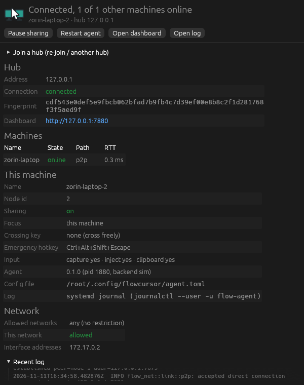

# ไอคอนและหน้าต่างสถานะ

`flow-tray` แสดงสถานะของ agent บนเครื่องนั้น Windows อยู่มุมขวาล่าง Linux อยู่แถบด้านบน
คลิกซ้ายเปิดหน้าต่างสถานะ คลิกขวาเปิดเมนู

| ไอคอน | สถานะ |
| :---: | :--- |
|  | ต่อ hub แล้ว พร้อมใช้ |
|  | กำลังคุมเครื่องอื่น หรือถูกเครื่องอื่นคุม |
|  | หยุดแชร์: กด Pause เอง หรืออยู่นอกวงที่อนุญาต (ไม่ใช่ข้อผิดพลาด) |
|  | ไม่ได้ต่อ hub หรือ agent ไม่ทำงาน (ไม่ใช่ข้อผิดพลาด) |
|  | ต้องแก้: ยังไม่ join, ถูกยกเลิกสิทธิ์, hub ปฏิเสธ, ไม่ได้รับสิทธิ์จาก GNOME หรือเซสชันควบคุมเปิดไม่ขึ้นทั้งที่ควรเปิด |

ตอน away, pause หรือยังไม่ต่อ hub เครื่องอื่นควบคุมเครื่องนี้ไม่ได้ ซึ่งเป็นเรื่องปกติ
(บน GNOME เซสชัน RemoteDesktop ปิดอยู่ และ clipboard ที่ผูกกับเซสชันนั้นก็ปิดด้วย)
หน้าต่างสถานะแสดงข้อความสีเทาว่าจะควบคุมได้อีกเมื่อไร เช่น เมื่อกลับเข้าวงที่อนุญาต เมื่อกด Resume หรือเมื่อต่อ hub ได้
ไม่ขึ้นเป็น Problem และไอคอนไม่เป็นสีแดง

## เมนู

ส่วนบนเป็นสถานะ: การเชื่อมต่อ hub, ชื่อเครื่อง, ใครคุมใคร, เส้นทางและ RTT ของแต่ละเครื่อง, เวอร์ชัน และสถานะอัปเดต

| คำสั่ง | ทำอะไร |
| :--- | :--- |
| Open status window | เปิดหน้าต่างสถานะ |
| Open dashboard | เปิด dashboard ของ hub ในเบราว์เซอร์ |
| Pause sharing / Resume sharing | หยุดแชร์ชั่วคราว ทำงานเหมือน away |
| Update now to … | อัปเดตเป็นเวอร์ชันของ hub (แสดงเมื่อมีเวอร์ชันใหม่) |
| Restart agent | restart agent |
| Open log | เปิด log ล่าสุด |
| Quit | Windows: ปิดทั้งไอคอนและ agent · Linux: ปิดเฉพาะไอคอน agent ยังทำงานต่อ |

Pause จะคงอยู่หลัง Restart agent แต่ปิดเครื่องหรือ login ใหม่จะกลับมาแชร์ตามปกติ กันลืม pause ทิ้งไว้

## หน้าต่างสถานะ



แสดงที่อยู่ hub และสาเหตุถ้าต่อไม่ได้, เครื่องอื่นพร้อมเส้นทางและ RTT, ปุ่มข้ามจอและ emergency hotkey ที่ใช้อยู่,
วงที่อนุญาตเทียบกับ IP ของเครื่อง, log ล่าสุด และฟอร์ม **Join a hub** สำหรับ join ครั้งแรกหรือย้าย hub
ถ้ายังไม่ได้ join หน้าต่างนี้จะเปิดเอง

เปิดได้จากเมนู tray, เมนูแอปชื่อ FlowCursor หรือ `flow-tray --show`

ข้อความในหน้าต่างเป็นภาษาอังกฤษ ชื่อเครื่องภาษาไทยแสดงได้ถ้าเครื่องมีฟอนต์ไทย
บน GNOME (Wayland) ถ้าหน้าต่างเปิดอยู่แล้ว กดเปิดซ้ำอาจไม่ขึ้นมาด้านหน้า เพราะ Wayland ไม่ให้โปรแกรมดึงหน้าต่างตัวเองขึ้นมา

## ไอคอนหายจากแถบ

tray ตรวจทุก 30 วินาทีว่า tray host (บน GNOME คือ extension AppIndicator) ยังแสดงไอคอนอยู่ ถ้าไม่เห็นจะลงทะเบียนใหม่เอง
ครอบคลุมกรณี GNOME Shell restart และปิดแล้วเปิด extension ใหม่
หลังอัปเดต tray เปิดตัวเองใหม่เป็น process ใหม่ (pid ใหม่) แล้ว process เก่าปิดตัว
ไม่ใช้ exec ทับ process เดิม เพราะชื่อบน D-Bus มาจาก pid และ extension จะลบไอคอนที่ใช้ชื่อซ้ำกับตัวเก่าที่เพิ่งหายไป

## คำสั่ง flow-agent

คำสั่งเดียวกับในเมนูใช้จาก terminal ได้:

```
flow-agent status | pause | resume | restart | stop | update
flow-agent join <token> [--hub <ที่อยู่>]
flow-agent forget-portal | monitors
```

บน GNOME `flow-agent status` บอกสถานะของ Input Capture และทางที่ใช้ด้วย:

```
input capture:    enabled (mutter direct), 1 barrier, zone set 7, session 2 (4m10s old)
last edge hit:    12s ago
capture change:   enabled with 1 barrier (4m09s ago)
remote control:   mutter direct
```

`zone set` คือรุ่นของการตั้งค่าจอที่ขอบจอถูกตั้งไว้ และ `session` คือจำนวน session ที่สร้างตั้งแต่ agent เริ่ม
`mutter direct` หรือ `portal` บอกว่าคุยกับ GNOME ทางไหน ดู [สิทธิ์ของ GNOME](install-linux.md#สิทธิ์ของ-gnome-wayland)
หน้าต่างสถานะแสดงแถว Edge capture แบบย่อ เช่น `enabled (mutter direct) · 1 barrier · last edge hit 12s ago`

tray กับคำสั่งเหล่านี้คุยกับ agent ผ่าน local IPC ที่เปิดให้เฉพาะผู้ใช้คนนั้น
Linux ใช้ Unix socket `$XDG_RUNTIME_DIR/flowcursor/agent.sock` และ Windows ใช้ named pipe ที่ผูกกับ SID ของผู้ใช้
รัน agent ซ้ำสองตัวในผู้ใช้เดียวกันไม่ได้
